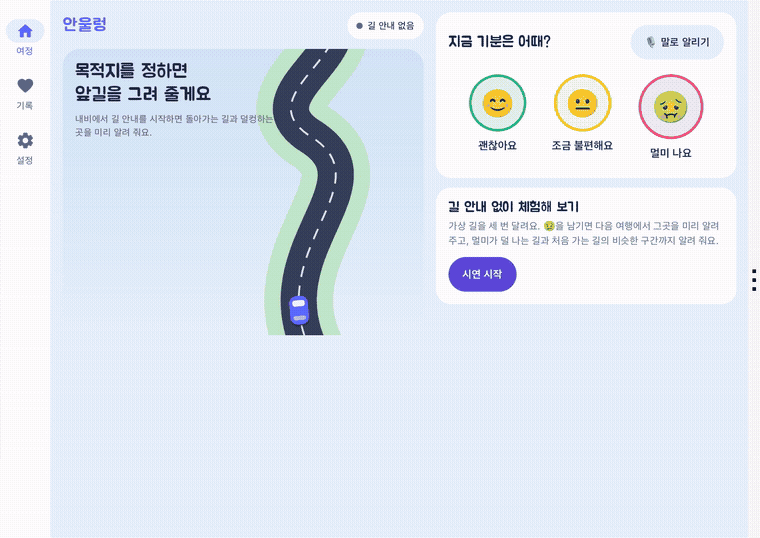
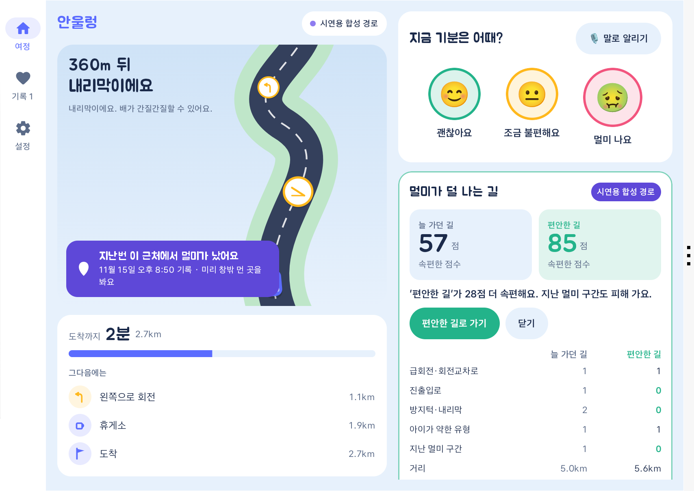
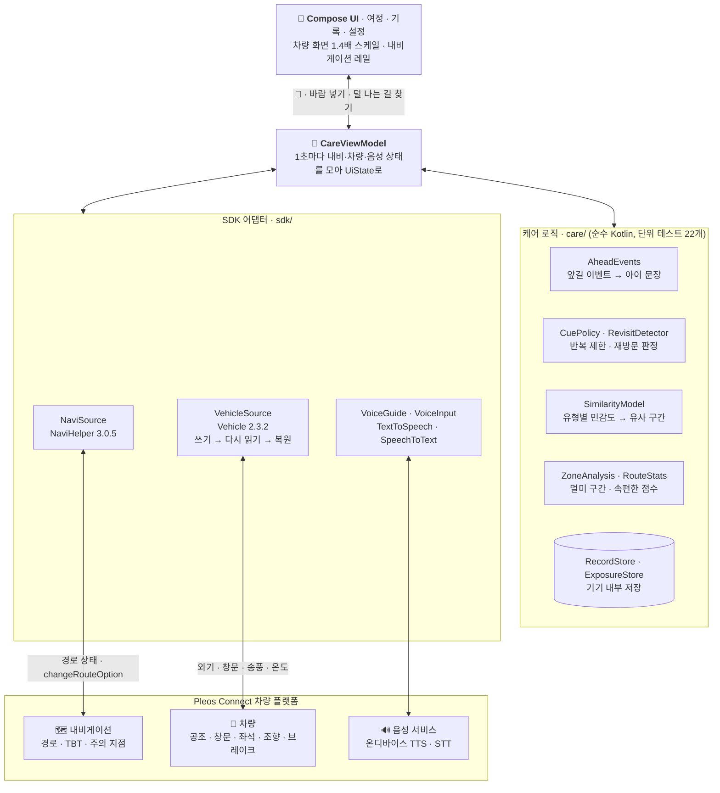
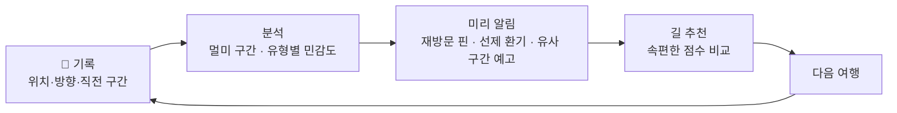

# 안울렁 (Anulreong) 🚗💨

**멀미가 난 곳을 기록·분석해 위험 구간을 미리 알리고, 멀미가 덜 나는 길을 추천하는 차량용 앱**

Team **Infotive** · 현대자동차그룹 차량용 앱 개발 공모전 · 주제: 패밀리 & 동승자 케어 · 플랫폼: **Pleos Connect** (Android Automotive 14)



▶ [시연 영상 전체 보기 (docs/demo.mp4)](docs/demo.mp4) · 📦 [release APK](apk/Infotive_Anulreong_release.apk) · 🧭 [3분 체험 방법](#-심사용-3분-체험)

> **시연 영상 (4분 16초, 1920×1080, 소리 있음)**
> - **0:00–1:17 · 실제 Pleos 내비 연동 (에뮬레이터 전체 화면).** 서울역 길 안내 중인 내비 → 안울렁에 같은 회전 안내와 남은 시간 → 🤢 기록 → 환기 케어(왼쪽 차량 패널과 하단 공조 바 포함) → 원래대로 → ‘멀미가 덜 나는 길 찾기’를 누르면 내비가 편안한 길 옵션으로 다시 탐색
> - **1:17–4:16 · 시연 모드 (앱 화면).** 합성 경로로 3번 여행: 기록 → 선제 케어·재방문 알림 → 속편한 점수 비교 → 처음 가는 길의 유사 구간 예측 → 기록 분석
> - 소리: 앱이 TextToSpeech에 보낸 안내 문장을 요청한 시각에 맞춰 **PC의 Windows 한국어 음성으로 재생**했습니다. 에뮬레이터 내장 TTS는 문장당 최대 30초 늦고 소리가 PC로 나오지 않습니다(영상에도 표시). 차는 정차(P) 상태라 내비 위치는 움직이지 않습니다.

---

## 30초 요약

| | |
|---|---|
| **문제** | 뒷좌석 아이는 차가 언제 돌고 덜컹할지 모르고, 운전자는 운전 중 아이 상태를 살필 수 없습니다. 내비는 거리·시간만 알려 주고 *멀미*는 모릅니다. |
| **해결** | 🤢 한 번 누르면 **그 자리와 그때 지나던 구간**이 기록됩니다. 다음에 그 길에 가까워지면 **미리 알리고 환기**하고, **속편한 점수**로 덜 흔들리는 길을 추천합니다. |
| **차별점** | ① 우리 아이 기록으로 학습하는 **유사 구간 예측**: 처음 가는 길이라도 아이가 약한 회전교차로 등을 미리 알려 줍니다 · ② 공조·창문을 **직접 제어하고 다시 읽어 확인**하는 차량 특화 케어 · ③ Pleos 내비 경로 옵션과 연동 |

## 핵심 기능

| | 기능 | 한 줄 설명 |
|---|---|---|
| 📍 | **기록 → 위험 구간** | 🤢 버튼 또는 음성("멀미 나")으로 위치·방향·직전 구간·핸들·브레이크를 기기 안에 기록하고, 300m 단위 *멀미 구간*으로 묶습니다 |
| 🔔 | **미리 알림 · 선제 케어** | 기록한 구간이 1.5km 앞에 나타나면 길 위에 표시하고, 600~900m 전에 환기를 제안하고, 400m 앞에서 음성으로 알립니다 |
| 🔮 | **유사 구간 예측** | 구간 유형별 *지나간 횟수 대비 멀미 비율*을 계산해 **처음 가는 길에서도** 아이가 약한 유형을 500m 앞에서 예고합니다 |
| 🛣️ | **멀미가 덜 나는 길** | 내비 ‘편안한 길’ 옵션으로 다시 찾고 두 길을 **속편한 점수(0~100, 높을수록 편안)**로 비교합니다. 원래 길로 한 번에 되돌릴 수 있습니다 |
| 🌬️ | **환기 케어** | 외기 전환 → 아이 쪽 창문 조금 열기 → 송풍 올리기 → 온도 낮추기. **단계마다 차량 값을 다시 읽어 확인**하고 버튼 한 번으로 원상 복원합니다 |
| 🚘 | **차량 신호 활용** | 뒷좌석 탑승 감지(창문 선택), 급조향·브레이크 기반 부드러운 운전 코칭, 휴게소 쉬어가기 제안 |

| 1번째 여행 · 🤢 기록 | 환기 케어 (차량 값 확인) | 속편한 점수 비교 | 유사 구간 예측 |
|---|---|---|---|
|  |  |  |  |

## 아키텍처



**데이터가 도는 방식:** 기록할수록 정확해집니다.



## 🧭 심사용 3분 체험

```bash
adb install -r apk/Infotive_Anulreong_release.apk
```

Pleos Connect 에뮬레이터에서 **안울렁** 실행 → 여정 화면의 **‘시연 시작’** (실차·길 안내 없이 합성 경로로 빨리감기)

1. **1번째 여행**: 회전교차로를 지난 뒤 **🤢 멀미 나요** → ‘바람 넣기’ → 단계별 확인 → ‘원래대로 돌리기’
2. **‘다음 여행 시작’**: 기록한 곳 전에 선제 환기 제안, 핀·알림 → **‘덜 나는 길 찾기’**로 속편한 점수 비교
3. **‘편안한 길로 가기’**: 처음 가는 길에서 회전교차로 *유사 구간 예측*
4. **기록 탭**: 아이가 힘들어하는 구간 유형, 자주 멀미 나는 장소

실제 내비로 확인하려면 설정 탭의 **‘서울역 안내’**(또는 내비에서 목적지 설정)를 누르세요. 배지가 **실시간 내비**로 바뀌고 내비와 같은 회전 안내·남은 시간이 나옵니다.

---

<details>
<summary><b>속편한 점수 계산식</b></summary>

```
감점 요소 = 급회전×3 + 진출입로×2 + 방지턱·내리막×2 + 일반 회전·합류×1
속편한 점수 = 100 − (감점 요소 / km) × 10 − 15 × (경로 위 멀미 구간 수) − 8 × (아이가 약한 유형 구간 수)   (0~100)
```

유사 구간 판정: 그 유형에서 멀미 기록 1회 이상 + (멀미 기록 ÷ 지나간 횟수) ≥ 30%. 이렇게 판정된 유형은 300m 대신 500m 앞에서 예고합니다.
</details>

<details>
<summary><b>정직하게 밝혀 두는 한계</b></summary>

- 위험 구간과 약한 구간 유형은 **이 가족이 남긴 기록**으로만 계산합니다. 다른 사용자 데이터나 의학적 모델은 쓰지 않습니다.
- 속편한 점수는 두 길을 비교하기 위한 값입니다. 멀미 확률이나 완화 효과를 뜻하지 않습니다.
- SDK가 경로의 좌표선·곡률을 주지 않습니다. 그래서 실제 경로에서 지난 멀미 구간을 피하는지는 1.5km 앞까지만 확인합니다. 시연 모드의 두 길은 모양을 모두 아는 합성 경로입니다.
- 공조 전원과 실내 조명 색은 바꾸지 않습니다. 에뮬레이터에서 바꾸면 시스템 UI가 다시 시작되기 때문입니다. 공조가 꺼져 있으면 송풍 단계는 건너뛰고 화면에 그렇게 표시합니다.
- 에뮬레이터의 온디바이스 TTS는 문장당 수십 초 지연될 수 있습니다. 모든 음성 안내는 화면에도 같이 표시합니다. 음성은 저장하지 않습니다.
- 에뮬레이터 내비는 지도 배경이 그려지지 않고 경로선과 안내만 표시됩니다. 차량이 정차 상태라 위치도 움직이지 않습니다.
- 실차 주행은 검증하지 않았습니다.
</details>

<details>
<summary><b>테스트 환경 및 설정</b></summary>

| 항목 | 값 |
|---|---|
| Pleos Connect 에뮬레이터 | Pleos Connect 2.1.0 시스템 이미지 (`system-images;android-34;pleos_car_emulator;x86_64`, Android 14 / API 34) |
| Android Emulator | 37.2.13 |
| 화면 규격 | **2560 × 1440 px, 160 dpi** (1600 × 900 dp, 가로) |
| AVD 설정 | RAM 4096MB, Cold boot, Graphics: Hardware(host GPU) |
| 빌드 도구 | AGP 8.8.0 · Gradle 8.10.2 · Kotlin 1.9.22 · JDK 17 · compileSdk 35 · minSdk 33 |
| Pleos SDK | NaviHelper 3.0.5 · Vehicle 2.3.2 · TextToSpeech 3.3.1 · SpeechToText 3.3.1 |
| UI | Jetpack Compose (Material 3) |

- 에뮬레이터에서 차량 제어 결과를 보려면 **Pleos Virtual Console 세션이 활성화**되어 있어야 합니다. 비활성이면 명령이 승인만 되고 값은 바뀌지 않습니다. 앱은 이 경우를 "요청했지만 그대로예요"로 표시합니다.
- 권한: `pleos.car.permission.NAVI_ROUTE`, `NAVI_ROUTE_SEARCH`, `CAR_CLIMATE`, `CONTROL_CAR_CLIMATE`, `CAR_WINDOWS`, `CONTROL_CAR_WINDOWS`, `CAR_DRIVE`, `READ_CAR_STEERING`, `CAR_SEATS`, `TTS_SERVICE`, `STT_SERVICE`
- 빌드: `./gradlew assembleRelease`, 테스트: `./gradlew testReleaseUnitTest` (22개). `keystore.properties`가 없으면 debug 키로 서명됩니다.
</details>

<details>
<summary><b>에뮬레이터 검증 결과 (2026-11-15)</b></summary>

| 항목 | 결과 |
|---|---|
| SDK 연결 | NaviHelper·Vehicle·TextToSpeech·SpeechToText 연결, 공조·창문·좌석 capability 조회 |
| 실시간 내비 | 서울역 경로 요청 → 안울렁에 "700m 뒤 오른쪽으로 돌아요", 도착까지 36분·23.0km 표시 (내비 화면과 일치) |
| 덜 나는 길 찾기 | `changeRouteOption(COMFORTABLE)` → 내비가 다시 탐색 → 두 길 모두 속편한 점수 93점("같아요")으로 정직하게 표시 |
| 환기 케어 | 외기·창문 20%·송풍 한 단계·온도 22.0→20.5℃를 쓰고 다시 읽어 "확인됨" 표시, 하단 공조 바에서도 변화 확인, ‘원래대로 돌리기’로 복원 |
| 시연 | 기록 → 선제 케어·재방문 알림 → 속편한 점수 비교(57 → 85점) → 편안한 길에서 유사 구간 예측 |
| 단위 테스트 | 22개 통과 (조사 처리, 유사 구간 학습·귀속, 통과 횟수 집계, 음성 키워드, 속편한 점수, 시연 흐름) |

SDK에서 확인한 동작: 내비가 안내 중일 때 `RouteStateInfo.naviMode`는 `ROUTE_GUIDING`인데 `isRouting`은 `false`였습니다. 그래서 안내 여부는 `naviMode`로 판단합니다.
</details>

<details>
<summary><b>코드 구조</b></summary>

```
app/src/main/java/io/infotive/anulleong/
├─ sdk/NaviSource.kt      NaviHelper 연결·콜백·경로 옵션 변경
├─ sdk/VehicleSource.kt   capability 확인 → 쓰기 → 별도 읽기로 확인 → 원상 복원, 좌석·조향·브레이크
├─ sdk/VoiceGuide.kt      TextToSpeech(온디바이스), 실패 시 화면 안내로 대체
├─ sdk/VoiceInput.kt      SpeechToText(온디바이스) → 😊/😐/🤢 키워드 매칭
├─ care/AheadEvents.kt    TBT·CautionPoint → 아이용 흔들림 예고
├─ care/Similarity.kt     구간 유형별 민감도(통과 횟수 대비 멀미 기록) → 유사 구간 예측
├─ care/CarePolicy.kt     안내 반복 제한, 중복 기록, 재방문(진행 방향·측면 거리) 판정
├─ care/Analysis.kt       멀미 구간 묶음, 속편한 점수·경로 비교
├─ care/DemoScenario.kt   시연용 합성 경로 2종(늘 가던 길 / 편안한 길)
├─ care/RecordStore.kt    기기 내부 기록 저장(원자적 쓰기)
├─ CareViewModel.kt       1초 tick으로 SDK 상태와 케어 로직을 합쳐 UiState 생성
└─ ui/                    MainScreen(여정·기록·설정), RoadHero(앞길 그림), EventIcon, Theme
docs/                     시연 영상·GIF, 화면 캡처
tools/                    시연 영상 촬영 스크립트(에뮬레이터 전용)
```
</details>

제목 서체 Jua: SIL Open Font License 1.1 ([FONT-LICENSE-Jua.txt](FONT-LICENSE-Jua.txt))
