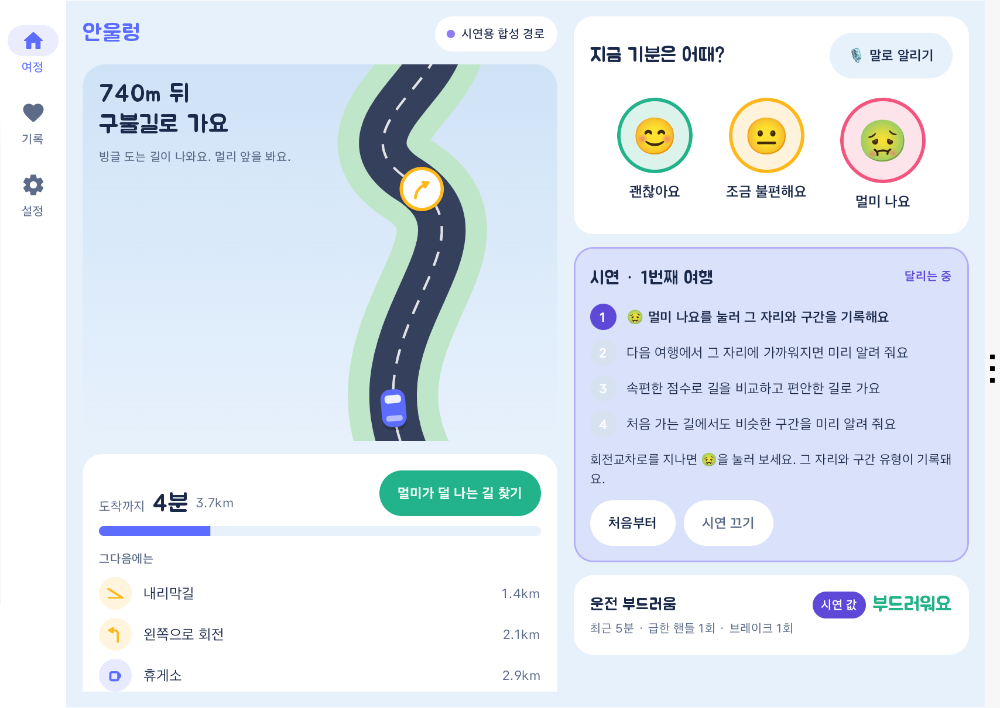
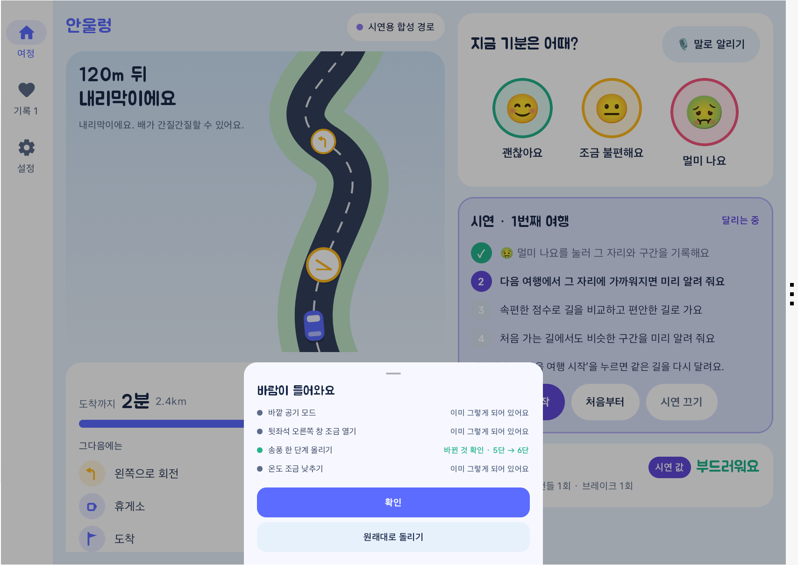
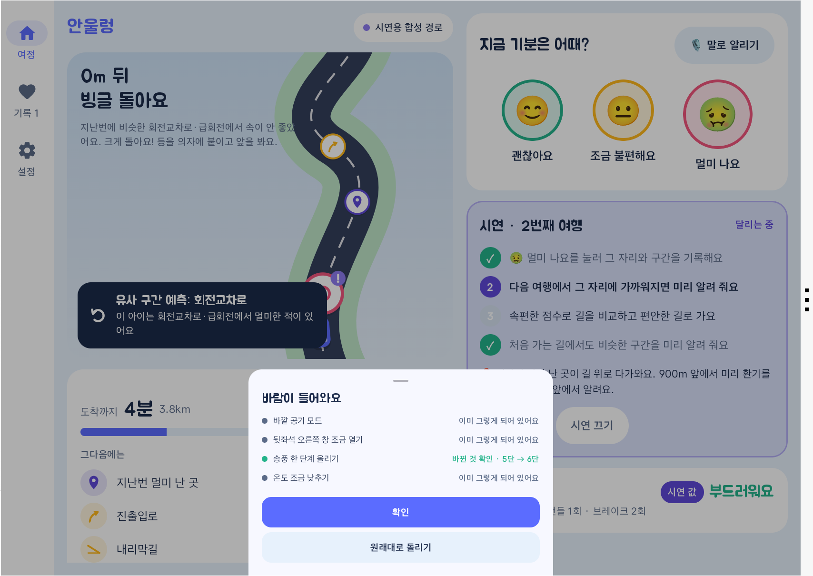
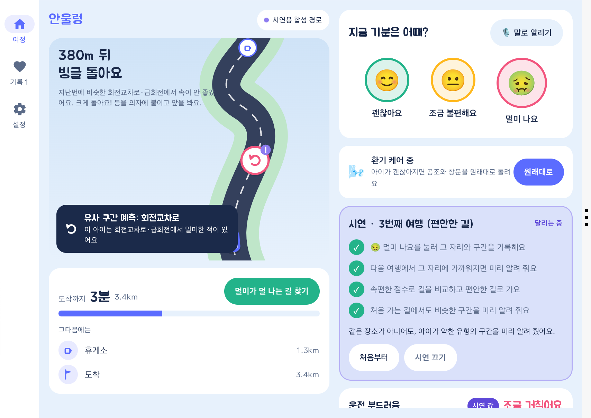
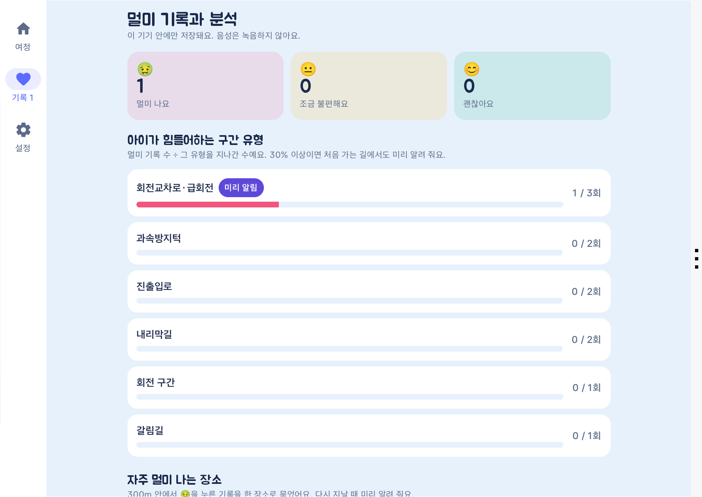

# 안울렁 (Anulreong)

> 멀미가 난 곳을 기록·분석해 위험 구간을 미리 알리고, 멀미가 덜 나는 길을 추천하는 차량용 앱

현대자동차그룹 차량용 앱 개발 공모전 출품작 · Team **Infotive** · 주제: 패밀리 & 동승자 케어


▶ 고화질 시연 영상: [docs/demo.mp4](docs/demo.mp4) (약 3분, Pleos Connect 에뮬레이터 화면 녹화, 소리 없음. GitHub에서 미리보기가 안 되면 파일 화면의 *View raw* 또는 다운로드로 재생하세요.)

## 어떤 플랫폼에서 쓰나요

**차량용 앱**입니다. 현대자동차그룹의 차량 인포테인먼트 플랫폼 **Pleos Connect**(Android Automotive 14 기반)의 센터 디스플레이에서 실행됩니다. 내비게이션(NaviHelper)·차량 제어(Vehicle)·음성 안내(TextToSpeech)·음성 인식(SpeechToText) 등 Pleos Connect SDK를 사용하므로 일반 휴대폰이 아닌 Pleos Connect 차량/에뮬레이터에서 동작합니다.

넓은 차량 화면(1600dp 이상)에서는 왼쪽 내비게이션 레일 + 2단 배치, 글자·터치 영역 1.4배 확대(버튼 최소 64dp)로 운전석·조수석에서 한눈에 보고 누를 수 있게 만들었고, 좁은 화면에서는 하단 탭의 1단 배치로 바뀝니다.

## 한 줄 시나리오

아이가 뒷좌석에서 "멀미 나" → 보호자가 🤢 한 번(또는 "멀미 나"라고 말하기) → 그 자리와 직전 구간이 기록되고 환기 케어 → 다음에 같은 곳에 가까워지면 **미리 환기하고 알림** → **속편한 점수**로 덜 흔들리는 길을 비교·추천 → 처음 가는 길이라도 **아이가 약한 구간 유형(예: 회전교차로)이 나오면 미리 예고**.

## 무엇을 하나요

| 기능 | 하는 일 | Pleos SDK |
|---|---|---|
| **앞길 미리 알림** | 내비의 회전 안내(TBT)와 주의 지점(과속방지턱·내리막 등)을 길 그림 위 그림 스티커와 아이 눈높이 문장("300m 뒤 왼쪽으로 돌아요. 앞 창문 먼 곳을 봐요!")으로 미리 알립니다. 같은 안내는 반복하지 않습니다. | NaviHelper, TextToSpeech |
| **멀미 기록 (버튼·음성)** | 😊 / 😐 / 🤢 버튼 또는 **🎙 말로 알리기**("멀미 나", "괜찮아" 등)로 기록합니다. 시각·위치·진행 방향·직전/앞 구간·핸들·브레이크·기어를 **기기 안에만** 저장합니다. | NaviHelper, Vehicle, SpeechToText |
| **멀미 구간 분석** | 300m 안의 🤢 기록을 한 "멀미 구간"으로 묶어 횟수와 그때 지나던 구간 유형을 보여줍니다. | — |
| **위험 구간 미리 알림** | 기록한 구간이 1.5km 앞 진행 방향 위에 있으면 길 위에 핀으로 보여주고, 400m 안에서 화면·음성으로 알립니다. | NaviHelper, TextToSpeech |
| **선제 케어** | 기록한 구간 600~900m 전에 "곧 지난번 멀미 난 곳이에요. 미리 바람을 넣을까요?"라고 먼저 제안합니다. | Vehicle |
| **유사 구간 예측** | 구간 유형별(회전교차로·급커브·진출입로·방지턱·내리막 …)로 *지나간 횟수 대비 멀미 기록 비율*을 학습합니다. 1회 이상 기록되고 비율이 30% 이상이면 "아이가 약한 구간"으로 표시하고, **처음 가는 길이라도** 그 유형이 나오면 500m 앞에서 더 일찍 예고합니다(보통 300m). | NaviHelper |
| **멀미가 덜 나는 길 추천** | ‘멀미가 덜 나는 길 찾기’를 누르면 내비 ‘편안한 길(COMFORTABLE)’ 옵션으로 다시 찾고, 이전 길과 새 길을 **속편한 점수**(0~100, 높을수록 편안)로 비교해 보여 줍니다. 마음에 들지 않으면 **원래 길로 되돌리기** 한 번으로 돌아갑니다. | NaviHelper `changeRouteOption` |
| **환기 케어** | 🤢을 누르면 "시원한 바람을 넣을까요?"라고 묻고, 확인하면 외기 모드 → 아이 쪽 창문 조금 열기 → 송풍 한 단계 올리기(공조가 켜져 있을 때) → 온도 조금 낮추기(20℃ 이상일 때 1.5℃)를 요청합니다. **각 단계마다 차량 값을 다시 읽어 확인된 것만 "완료"로 표시**하고, 버튼 한 번으로 원래 값으로 되돌립니다. | Vehicle (HVAC, Window) |
| **차량 특화 감지** | 뒷좌석 탑승 감지로 아이 자리 쪽 창문을 고르고, 급조향(90°/s 이상)·브레이크 횟수를 세어 🤢 기록 시 "조금 더 부드럽게 운전해 볼까요?" 운전 코칭(10분에 한 번), 이번 여행에서 🤢이 두 번 이상이고 휴게 구간이 5km 안에 있으면 쉬어가기 제안. | Vehicle (Seat, Steering, Brake, DrivingMode) |
| **시연 모드** | 실차 없이 기록 → 선제 케어·알림 → 길 추천 → 유사 구간 예측까지 체험하는 가상 경로 3회 여행. "시연용 합성 경로"가 항상 표시되고, 시연 기록은 실제 주행에 섞이지 않습니다. | — |

### 속편한 점수 계산

```
감점 요소 = 급회전×3 + 진출입로×2 + 방지턱·내리막×2 + 일반 회전·합류×1
속편한 점수 = 100 − (감점 요소 / km) × 10 − 15 × (경로 위 멀미 구간 수) − 8 × (아이가 약한 유형 구간 수)   (0~100)
```

### 정직하게 밝혀 두는 한계

- "위험 구간"과 "약한 구간 유형"은 **이 가족이 직접 남긴 기록**에서만 계산합니다. 다른 사용자 데이터나 의학적 모델을 쓰지 않습니다.
- 속편한 점수는 길을 서로 비교하기 위한 값이며 멀미 확률이나 완화 효과가 아닙니다.
- SDK가 경로의 실제 모양(좌표선·곡률)을 주지 않아, 실제 경로에서 지난 멀미 구간을 피하는지는 1.5km 앞까지만 확인됩니다. 시연 모드의 두 길은 모양을 모두 아는 합성 경로입니다.
- 실내 조명(앰비언트) 색 변경은 에뮬레이터에서 시스템 UI가 다시 시작되는 문제가 있어 이번 버전의 환기 케어에서 뺐습니다.
- 음성 인식은 온디바이스 STT를 쓰며 에뮬레이터에서는 인식 품질이 낮을 수 있어, 버튼 입력을 항상 함께 제공합니다. 음성은 저장하지 않습니다.
- 실차 주행에서의 동작은 검증하지 않았습니다(아래 ‘검증하지 않은 것’ 참고).

## 실행 방법

### APK 설치

```bash
adb install -r apk/Infotive_Anulreong_release.apk
```

Pleos Connect 에뮬레이터 앱 목록에서 **안울렁**을 실행합니다.

### 시연 모드로 체험하기 (약 3분, 실차·길 안내 없이)

1. 여정 화면의 **‘시연 시작’**. 가상 경로를 빨리감기로 달립니다(시작할 때마다 시연 기록 초기화).
2. **1번째 여행** – 회전교차로를 지난 뒤 **🤢 멀미 나요** → ‘바람 넣기’ → 단계별 확인 결과 → ‘원래대로 돌리기’.
3. 시연 안내의 **‘다음 여행 시작’** → **2번째 여행** – 기록한 곳 전에 **선제 케어** 제안, 다가가면 핀과 알림 → **‘멀미가 덜 나는 길 찾기’**로 속편한 점수 비교.
4. **‘편안한 길로 가기’** → **3번째 여행** – 처음 가는 길인데도 회전교차로 앞에서 “아이가 약한 구간” 예고(유사 구간 예측).
5. **기록 탭**에서 “아이가 힘들어하는 구간 유형”과 “자주 멀미 나는 장소” 분석을 확인합니다.

### 실제 내비 데이터로 확인하기

Pleos 내비에서 목적지를 설정하면 배지가 **실시간 내비**로 바뀌고 실제 TBT·잔여 거리/시간이 표시됩니다. 부팅 직후 내비 지도가 준비되기 전에는 경로 요청이 무시되므로, 내비 앱을 한 번 연 뒤 사용하세요.

### 소스에서 빌드

```bash
./gradlew assembleRelease        # app/build/outputs/apk/release/app-release.apk
```

```bash
./gradlew testReleaseUnitTest    # 단위 테스트 22개
```

`keystore.properties`(저장소에 포함하지 않음)가 없으면 release 빌드는 debug 키로 서명됩니다.

## 화면

| 1번째 여행 · 멀미 기록 | 환기 케어 결과(차량 값 확인) |
|---|---|
|  |  |
| **선제 케어 · 재방문 알림** | **속편한 점수 비교** |
|  |  |
| **유사 구간 예측(처음 가는 길)** | **기록 분석** |
|  |  |

## 테스트 환경 및 설정

| 항목 | 값 |
|---|---|
| Pleos Connect 에뮬레이터 | Pleos Connect 2.1.0 시스템 이미지 (`system-images;android-34;pleos_car_emulator;x86_64`, Android 14 / API 34) |
| Android Emulator | 37.2.13 |
| 화면 규격 | **2560 × 1440 px, 160 dpi** (1600 × 900 dp, 가로) |
| AVD 설정 | RAM 4096MB, Cold boot, Graphics: Hardware(host GPU) |
| 빌드 도구 | AGP 8.8.0 · Gradle 8.10.2 · Kotlin 1.9.22 · JDK 17 · compileSdk 35 · minSdk 33 |
| Pleos SDK | NaviHelper 3.0.5 · Vehicle 2.3.2 · TextToSpeech 3.3.1 · SpeechToText 3.3.1 |
| UI | Jetpack Compose (Material 3) |

- 차량 제어 결과를 에뮬레이터에서 확인하려면 **Pleos Virtual Console 세션이 활성화**되어 있어야 합니다. 비활성이면 명령이 승인만 되고 값이 바뀌지 않으며, 앱은 이를 "요청했지만 그대로예요"로 정직하게 표시합니다.
- 권한(`AndroidManifest.xml`): `pleos.car.permission.NAVI_ROUTE`, `NAVI_ROUTE_SEARCH`, `CAR_CLIMATE`, `CONTROL_CAR_CLIMATE`, `CAR_WINDOWS`, `CONTROL_CAR_WINDOWS`, `CAR_DRIVE`, `READ_CAR_STEERING`, `CAR_SEATS`, `TTS_SERVICE`, `STT_SERVICE`

## APK 위치

[`apk/Infotive_Anulreong_release.apk`](apk/Infotive_Anulreong_release.apk) (release 빌드 v1.1.0, 서명됨)

## 에뮬레이터 검증 결과 (2026-11-15)

| 항목 | 결과 |
|---|---|
| SDK 연결 | NaviHelper·Vehicle·TextToSpeech·SpeechToText 연결, 공조·창문·좌석 capability 조회 |
| 실시간 내비 | 서울역 경로 요청 → "700m 뒤 오른쪽으로 돌아요", 도착까지 76분·23.0km (내비 화면과 일치) |
| 환기 케어 | 외기 모드·창문·송풍·온도 각 단계를 쓴 뒤 다시 읽어 "확인됨" 표시, ‘원래대로 돌리기’로 복원 확인 |
| 시연 | 기록 → 선제 케어·재방문 알림 → 속편한 점수 비교 → 편안한 길에서 유사 구간 예측 (시연 영상) |
| 단위 테스트 | 22개 통과 (조사 처리, 유사 구간 학습·귀속, 통과 횟수 집계, 음성 키워드, 속편한 점수, 시연 흐름) |

SDK에서 확인한 동작: 내비가 안내 중일 때 `RouteStateInfo.naviMode`는 `ROUTE_GUIDING`이지만 `isRouting`은 `false`였습니다. 그래서 안내 여부를 `naviMode`로 판단합니다.

검증하지 않은 것: 실제 주행 중 거리 갱신, 실차에서의 `COMFORTABLE` 재탐색 결과, 실차 좌석 감지·조향 신호, TTS·STT의 실차 품질.

## 구조

```
app/src/main/java/io/infotive/anulleong/
├─ sdk/NaviSource.kt      NaviHelper 연결·콜백·경로 옵션 변경
├─ sdk/VehicleSource.kt   capability 확인 → 쓰기 → 별도 읽기로 확인 → 원상 복원, 좌석·조향·브레이크
├─ sdk/VoiceGuide.kt      TextToSpeech(온디바이스), 실패 시 화면 안내로 대체
├─ sdk/VoiceInput.kt      SpeechToText(온디바이스) → 😊/😐/🤢 키워드 매칭
├─ care/AheadEvents.kt    TBT·CautionPoint → 아이용 흔들림 예고
├─ care/Similarity.kt     구간 유형별 민감도 학습(통과 횟수 대비 멀미 기록) → 유사 구간 예측
├─ care/CarePolicy.kt     안내 반복 제한, 중복 기록, 재방문(진행 방향·측면 거리) 판정
├─ care/Analysis.kt       멀미 구간 묶음, 속편한 점수·경로 비교
├─ care/DemoScenario.kt   시연용 합성 경로 2종(늘 가던 길 / 편안한 길)
├─ care/RecordStore.kt    기기 내부 기록 저장(원자적 쓰기)
├─ CareViewModel.kt       상태 조합
└─ ui/                    MainScreen(여정·기록·설정 탭), RoadHero(앞길 그림), EventIcon, Theme
docs/demo.mp4, demo.gif   시연 영상
docs/screenshots/         화면 캡처(앱 창 기준)
tools/capture-demo.ps1    시연 영상 촬영 스크립트(에뮬레이터 전용)
```

## 라이선스 고지

제목 서체 Jua: SIL Open Font License 1.1 ([FONT-LICENSE-Jua.txt](FONT-LICENSE-Jua.txt))
