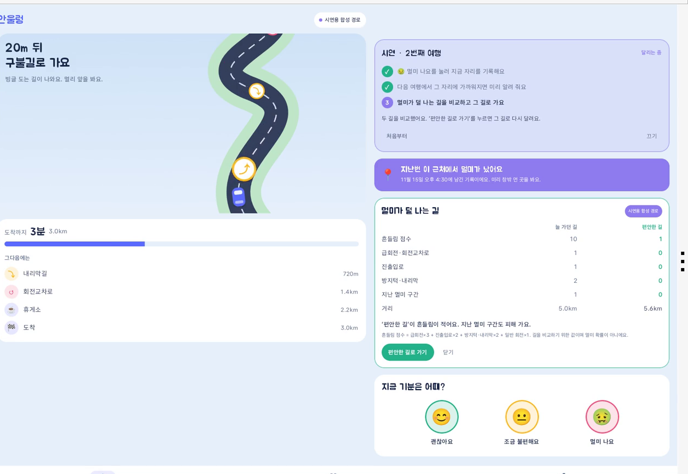

# 안울렁 (Anulreong)

> 멀미가 난 곳을 기록·분석해 위험 구간을 미리 알리고, 멀미가 덜 나는 길을 추천하는 차량용 앱

현대자동차그룹 차량용 앱 개발 공모전 출품작 · Team **Infotive** · 주제: 패밀리 & 동승자 케어



## 어떤 플랫폼에서 쓰나요

**차량용 앱**입니다. 현대자동차그룹의 차량 인포테인먼트 플랫폼 **Pleos Connect**(Android Automotive 14 기반)의 센터 디스플레이에서 실행됩니다. 내비게이션(NaviHelper)·차량 제어(Vehicle)·음성(TextToSpeech) 등 Pleos Connect SDK를 사용하므로 일반 휴대폰이 아닌 Pleos Connect 차량/에뮬레이터에서 동작합니다. 화면은 넓은 차량 디스플레이에서는 2단으로, 좁은 화면에서는 휴대폰 앱처럼 1단으로 배치되는 반응형입니다.

## 시연 영상

[docs/demo.mp4](docs/demo.mp4) (약 2분, Pleos Connect 에뮬레이터 화면 녹화, 소리 없음)

기록 → 기록 기반 알림 → 멀미가 덜 나는 길 추천까지를 시연 모드로 한 번에 보여줍니다.

## 무엇을 하나요

| 기능 | 하는 일 | Pleos SDK |
|---|---|---|
| **앞길 흔들림 예고** | 내비의 회전 안내(TBT)와 주의 지점(과속방지턱·내리막·노면)을 길 그림 위 스티커와 아이 눈높이 문장("300m 뒤 왼쪽으로 돌아요. 앞 창문 먼 곳을 봐요!")으로 미리 알리고, 같은 안내는 반복하지 않습니다. | NaviHelper, TextToSpeech |
| **멀미 기록** | 😊 / 😐 / 🤢 버튼을 누르면 시각·위치·진행 방향·앞에 있던 구간·핸들 각도·브레이크·기어를 기기 안에만 저장합니다. 10초 안의 중복 입력과 60초보다 오래된 위치는 거릅니다. | NaviHelper, Vehicle |
| **멀미 구간 분석** | 300m 안의 🤢 기록을 한 "멀미 구간"으로 묶어 횟수와 그때 주로 앞에 있던 구간(예: 회전교차로)을 보여줍니다. | — |
| **위험 구간 미리 알림** | 기록한 구간이 1.5km 앞 진행 방향 위에 있으면 길 위에 📍 핀으로 보여주고, 400m 안에 들어오면 "이 근처에서 N번 멀미가 났어요"라고 화면과 음성으로 알립니다. | NaviHelper, TextToSpeech |
| **멀미가 덜 나는 길 추천** | 지금 길과 내비의 ‘편안한 길(COMFORTABLE)’ 옵션으로 다시 찾은 길을 흔들림 점수(급회전×3 + 진출입로×2 + 방지턱·내리막×2 + 일반 회전×1)로 비교해 보여줍니다. | NaviHelper `changeRouteOption` |
| **환기 케어** | 🤢을 누르면 "시원한 바람을 넣을까요?"라고 묻고, 확인하면 외기 모드로 바꾸고 뒷좌석 창문을 조금 엽니다. **명령 후 차량 상태를 다시 읽어 확인된 경우에만 "완료"로 표시**하고 버튼 한 번으로 원래대로 되돌립니다. | Vehicle (HVAC, Window) |
| **시연 모드** | 실차 없이도 기록 → 알림 → 길 추천을 체험할 수 있는 가상 경로 3회 여행. 화면에 "시연용 합성 경로"가 항상 표시되고, 시연 기록은 실제 주행 알림에 섞이지 않습니다. | — |

### 정직하게 밝혀 두는 한계

- "위험 구간"은 **이 가족이 직접 남긴 기록**입니다. 다른 사용자 데이터나 도로 곡률로 멀미를 예측하지 않습니다.
- 흔들림 점수는 길을 서로 비교하기 위한 값이며 멀미 확률이 아닙니다.
- SDK가 경로의 실제 모양(좌표선·곡률)을 주지 않아, 실제 경로에서 지난 멀미 구간을 피하는지는 1.5km 앞까지만 확인됩니다. 시연 모드의 두 길은 모양을 모두 알고 있는 합성 경로입니다.
- TBT 목록은 첫 항목만 현재 위치 기준 거리로 씁니다. 에뮬레이터 실측에서 이후 항목의 거리는 증가 순서가 아니었습니다(700→50→110m).
- 멀미 완화 효과를 측정하거나 주장하지 않습니다. 기록은 기기 내부에만 저장되며 음성은 녹음하지 않습니다.
- 음성 입력(STT)은 에뮬레이터에서 인식 품질이 부족해(지연·오인식) 이번 버전에서는 버튼 입력을 사용합니다.

## 실행 방법

### APK 설치

```bash
adb install -r apk/Infotive_Anulreong_release.apk
```

Pleos Connect 에뮬레이터 앱 목록에서 **안울렁**을 실행합니다.

### 시연 모드로 체험하기 (실차·길 안내 없이)

1. 여정 탭의 **‘시연 시작’**을 누릅니다. 가상 경로를 빨리감기로 달립니다.
2. **1번째 여행**: 달리는 중 **🤢 멀미 나요**를 누릅니다. 그 자리가 기록되고 환기를 제안합니다.
3. 시연 가이드의 **‘다음 여행 시작’** → **2번째 여행**: 기록한 곳이 📍 핀으로 다가오고 400m 앞에서 알림이 뜹니다.
4. **‘덜 나는 길 찾기’** → 늘 가던 길과 편안한 길 비교 → **‘편안한 길로 가기’** → **3번째 여행**: 지난 멀미 구간을 지나지 않아 알림이 뜨지 않습니다.
5. **기록 탭**에서 멀미 구간 분석을 확인합니다. ‘처음부터’를 누르면 시연 기록만 지우고 다시 시작합니다.

### 실제 내비 데이터로 확인하기

연결 탭의 **‘서울역 안내’**를 누르거나 Pleos 내비에서 목적지를 설정하면 배지가 **실시간 내비**로 바뀌고 실제 TBT·잔여 거리/시간이 표시됩니다. 부팅 직후 내비 지도가 준비되기 전에는 경로 요청이 무시되므로, 내비 앱을 한 번 연 뒤 요청하세요.

### 소스에서 빌드

```bash
./gradlew assembleRelease        # app/build/outputs/apk/release/app-release.apk
./gradlew testReleaseUnitTest    # 단위 테스트 15개
```

`keystore.properties`(저장소에 포함하지 않음)가 없으면 release 빌드는 debug 키로 서명되어 누구나 설치 가능한 APK가 만들어집니다.

## 테스트 환경 및 설정

| 항목 | 값 |
|---|---|
| Pleos Connect 에뮬레이터 | Pleos Connect 2.1.0 시스템 이미지 (`system-images;android-34;pleos_car_emulator;x86_64`, Android 14 / API 34) |
| Android Emulator | 37.2.13 |
| 화면 규격 | **2560 × 1440 px, 160 dpi** (1600 × 900 dp, 가로) |
| AVD 설정 | RAM 4096MB, Cold boot, Graphics: Hardware(host GPU) |
| 빌드 도구 | AGP 8.8.0 · Gradle 8.10.2 · Kotlin 1.9.22 · JDK 17 · compileSdk 35 · minSdk 33 |
| Pleos SDK | NaviHelper 3.0.5 · Vehicle 2.3.2 · TextToSpeech 3.3.1 |
| UI | Jetpack Compose (Material 3) |

- 차량 제어(외기·창문) 결과를 에뮬레이터에서 확인하려면 **Pleos Virtual Console 세션이 활성화**되어 있어야 합니다. 비활성이면 명령이 승인만 되고 값이 바뀌지 않으며, 앱은 이를 "요청했지만 그대로예요"로 표시합니다.
- 필요한 권한(`AndroidManifest.xml`에 선언): `pleos.car.permission.NAVI_ROUTE`, `NAVI_ROUTE_SEARCH`, `CAR_CLIMATE`, `CONTROL_CAR_CLIMATE`, `CAR_WINDOWS`, `CONTROL_CAR_WINDOWS`, `CAR_DRIVE`, `READ_CAR_STEERING`, `TTS_SERVICE`

## APK 위치

[`apk/Infotive_Anulreong_release.apk`](apk/Infotive_Anulreong_release.apk) (release 빌드, 서명됨)

## 에뮬레이터 검증 결과 (2026-11-15)

| 항목 | 결과 |
|---|---|
| SDK 연결 | NaviHelper·Vehicle·TextToSpeech 모두 연결 (기어 PARK, 공기 순환·뒷좌석 오른쪽 창 읽기·쓰기 가능, 창 범위 0~10) |
| 실시간 내비 | 서울역 경로 요청 → "700m 뒤 오른쪽으로 돌아요", 도착까지 76분·23.0km (내비 화면 1시간 18분·23km와 일치) |
| 환기 케어 | 뒷좌석 오른쪽 창 0% → 20% (SDK 값 0 → 2)를 다시 읽어 "바뀐 것 확인", 원래대로 0%로 복원 확인 |
| 기록·분석 | 저장·삭제, 재부팅 후 유지, 멀미 구간 묶음 표시 |
| 시연 | 기록 → 2번째 여행 알림 → 길 비교 → 편안한 길에서 알림 없음 (시연 영상) |

SDK에서 확인한 동작: 내비가 실제로 안내 중일 때 `RouteStateInfo.naviMode`는 `ROUTE_GUIDING`이지만 `isRouting`은 `false`였습니다. 그래서 안내 여부를 `naviMode`로 판단합니다.

검증하지 않은 것: 실제 주행 중 거리 갱신, 경로 재탐색·취소 중 화면 전환, 실차에서의 `COMFORTABLE` 재탐색 결과, TTS가 스피커로 끝까지 재생되는지, 실제 휴대폰 크기 화면.

## 구조

```
app/src/main/java/io/infotive/anulleong/
├─ sdk/NaviSource.kt      NaviHelper 연결·콜백·3초 주기 갱신·경로 옵션 변경
├─ sdk/VehicleSource.kt   capability 확인 → 쓰기 → 별도 읽기로 확인 → 원상 복원
├─ sdk/VoiceGuide.kt      TextToSpeech(온디바이스), 실패 시 화면 안내로 대체
├─ care/AheadEvents.kt    TBT·CautionPoint → 아이용 흔들림 예고
├─ care/CarePolicy.kt     안내 반복 제한, 중복 기록, 재방문(진행 방향·측면 거리) 판정
├─ care/Analysis.kt       멀미 구간 묶음, 경로 흔들림 점수·비교
├─ care/DemoScenario.kt   시연용 합성 경로 2종(늘 가던 길 / 편안한 길)
├─ care/RecordStore.kt    기기 내부 기록 저장(원자적 쓰기)
├─ CareViewModel.kt       상태 조합
└─ ui/                    MainScreen(여정·기록·연결 탭), RoadHero(앞길 그림), Theme
docs/demo.mp4             시연 영상
docs/screenshots/         화면 캡처
tools/record-demo.ps1     시연 영상 녹화 스크립트(에뮬레이터 전용)
```

## 라이선스 고지

제목 서체 Jua: SIL Open Font License 1.1 ([FONT-LICENSE-Jua.txt](FONT-LICENSE-Jua.txt))
